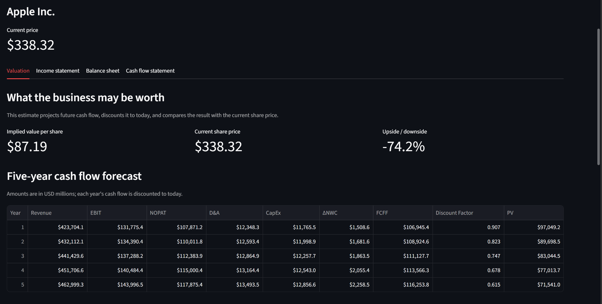
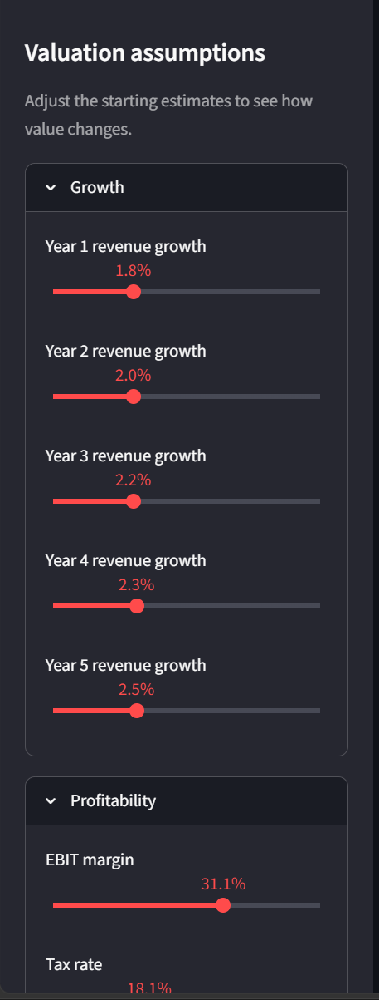
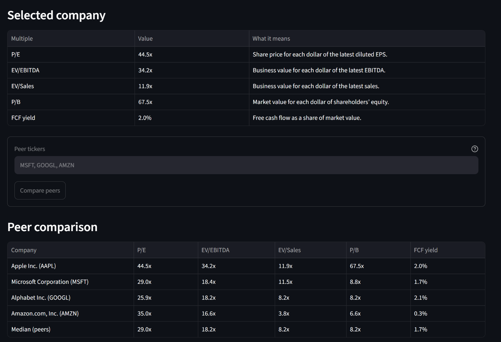
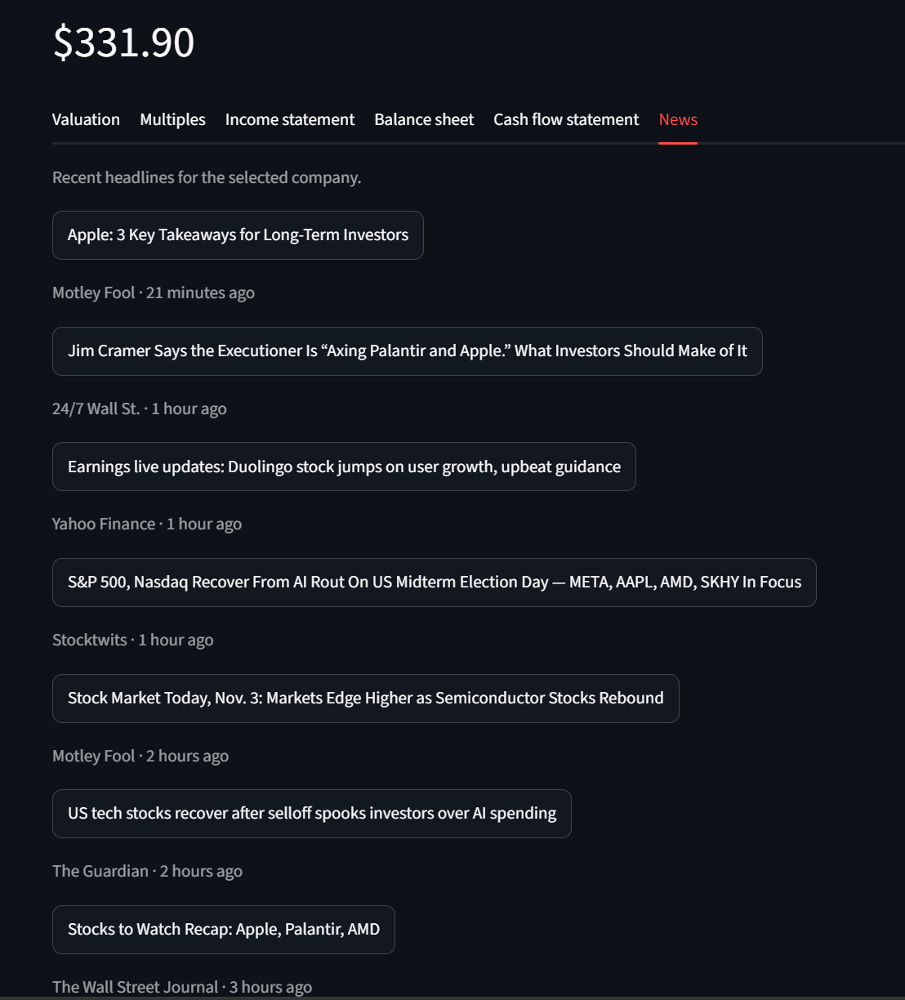

# DCF Valuation Tool

Type a stock ticker and get an automatically built discounted cash flow (DCF) valuation, with every assumption adjustable, a sensitivity grid, a Monte Carlo simulation, peer multiples, cleaned financial statements and recent news.

**Live app:** [easy-dcf.streamlit.app](https://easy-dcf.streamlit.app)

> If charts, tables or buttons show a red "Failed to fetch dynamically imported module" error, an ad blocker or privacy extension is blocking Streamlit's files. Allow-list the site or pause the blocker, then hard refresh (Ctrl+Shift+R).



## Features

- **Auto-built DCF.** Pulls a company's financials and market data, derives every assumption from its history, and outputs an implied value per share against the current price.
- **Adjustable assumptions.** A sidebar slider or input for each variable in the model: revenue growth by year, margins, tax, reinvestment, each WACC component and the terminal value. A growth profile selector fills the five growth sliders with a preset: **Fade** (historical growth easing to terminal growth), **Flat** (historical growth held for five years) or **Custom** (set each year yourself). The valuation updates instantly, and a reset button restores the defaults.
- **Sensitivity grid.** Value per share across WACC × terminal growth (or × exit multiple), with the current case highlighted.
- **Monte Carlo simulation.** Runs the DCF thousands of times, randomly varying revenue growth, EBIT margin, WACC and the terminal assumption around your sidebar values, and shows the spread of outcomes: a histogram of value per share marked with the current price, the base case and the P10, P50 and P90 values, a percentile table, and the chance the stock is worth more than its price.
- **Multiples and peers.** P/E, EV/EBITDA, EV/Sales, P/B and FCF yield, compared with any peer tickers you enter, plus a cross-check of the DCF value against peer P/E.
- **Clean financial statements.** Income statement, balance sheet and cash flow in USD millions, with margin and growth rows.
- **News.** Recent headlines for the ticker with source and time.
- **Guardrails.** Friendly errors for bad tickers, and a warning for banks and insurers, where a standard DCF doesn't fit.

## How the valuation works

The model projects five years of unlevered free cash flow and discounts it at the weighted average cost of capital.

| Step | Formula |
| --- | --- |
| Free cash flow | FCFF = EBIT × (1 − tax) + D&A − CapEx − ΔNWC |
| Cost of equity | CAPM: risk-free rate + beta × equity risk premium |
| WACC | E/(D+E) × cost of equity + D/(D+E) × cost of debt × (1 − tax) |
| Terminal value | Gordon growth: FCFF₅ × (1 + g) / (WACC − g), or exit multiple: EBITDA₅ × multiple |
| Equity value | Enterprise value − debt + cash and marketable securities |

### Default assumptions

| Input | How the default is derived |
| --- | --- |
| Revenue growth | Historical revenue CAGR, capped at −5% to 20%, fading linearly to terminal growth by year 5 (the Fade profile; Flat holds the CAGR instead) |
| EBIT margin, D&A %, CapEx % | 3-year averages as a share of revenue |
| ΔNWC | Total working-capital investment ÷ total revenue added over the last 3 years, clamped to −10% to 20%. It can be negative for businesses their suppliers fund, like Costco. Falls back to 5% when revenue shrank or barely grew. |
| Tax rate | 3-year effective rate, clamped to 10–30% |
| Risk-free rate | Current 10-year U.S. Treasury yield |
| Beta / equity risk premium | Adjusted beta: ⅔ × raw beta + ⅓ × 1.0 (the Blume adjustment Bloomberg reports), because measured betas drift toward 1.0 over time. Raw beta comes from Yahoo Finance, or on the hosted app is estimated from 5 years of monthly returns against the S&P 500. / 5.0% |
| Cost of debt | Interest expense ÷ total debt; falls back to risk-free + 1.5% |
| Terminal growth / exit multiple | 2.5% / current EV/EBITDA |

EBITDA always means operating income + D&A, the same measure the exit-multiple terminal value is applied to. Yahoo's own EBITDA figure starts from pretax income and can differ by 20% or more, so it isn't used.

The Valuation tab lists every assumption with its value and source, and marks any you've edited.

## Monte Carlo simulation

The single DCF answer depends on one set of assumptions. The Monte Carlo tab runs the same model 1,000 to 25,000 times, each time nudging the inputs at random around the sidebar values, to show how wide the plausible range is.

| Input | How it varies |
| --- | --- |
| Revenue growth | One shock per trial applied to all five years, plus smaller yearly noise, so a trial that grows slowly tends to grow slowly every year. Each year's spread equals the chosen standard deviation. |
| EBIT margin | One shock per trial, held for all five years |
| WACC | Drawn around the sidebar value, never below 1% |
| Terminal growth (Gordon) | Drawn around the sidebar value, then capped at WACC − 0.5% so the formula stays finite. The tab reports how often the cap applied. |
| Exit multiple | Drawn around the sidebar value, never below 1× |

Draws are Normal or Triangular, with the standard deviation for each input set in the tab, and a seed lock that keeps results steady between reruns. The engine (`model/monte_carlo.py`) works on NumPy arrays of shape (simulations, years) instead of building a table per trial, so 10,000 trials take milliseconds.

It reuses the DCF's exact math, and the tests prove it: with every standard deviation set to zero, each simulated value matches `run_dcf` to within 1e-9, for Gordon and exit multiple, with the mid-year convention on and off.

## Data sources

The app tries each source in order and labels what it used:

1. **Yahoo Finance** (via yfinance): statements, price, beta and news. Used whenever it works, which is usually the case when running locally.
2. **SEC EDGAR + Yahoo prices**: Yahoo blocks statement requests from shared cloud servers like Streamlit Cloud, but still serves price history. The app then reads annual statements from the SEC's free [XBRL API](https://www.sec.gov/search-filings/edgar-application-programming-interfaces) (`data/sec.py`), and estimates beta from five years of monthly returns against the S&P 500. Statements are reused for 6 hours; the price and Treasury yield refresh every 10 minutes.
3. **Saved snapshots**: real data saved for about 25 popular tickers (`data/snapshots/`), shown with the date it was saved if both live sources fail.

The SEC asks API users to identify themselves, so the SEC step only runs when a `SEC_USER_AGENT` setting is present, such as `DCF Tool your.email@example.com`. On Streamlit Cloud it's set under **Settings → Secrets**:

```toml
SEC_USER_AGENT = "DCF Tool your.email@example.com"
```

`python scripts/check_sec.py` compares SEC-based numbers with Yahoo's for a set of tickers. `python scripts/make_snapshots.py` refreshes the snapshots.

## Verifying the math

The DCF engine is pure Python with no data or UI code, so it can be tested on its own. The tests check it against a hand-built Excel model ([`docs/DCF_Answer_Key.xlsx`](docs/DCF_Answer_Key.xlsx)) using a simple test company. The engine has to match the spreadsheet to the cent:

| Output | Expected |
| --- | --- |
| WACC | 8.80% |
| Enterprise value (Gordon) | 4,705.16 |
| Value per share (Gordon) | $46.05 |
| Value per share (10× exit multiple) | $41.40 |

Other tests cover the assumption clamps and unit conversions, the multiples, the news parser (using a saved real response), terminal growth ≥ WACC raising an error (for Gordon growth only), and the mid-year convention. With mid-year discounting on, a Gordon terminal value uses the final year's mid-year factor, while an exit-multiple terminal value, which models a sale at the end of year 5, is discounted over the full five years. The Monte Carlo engine is tested against `run_dcf` as described above, plus checks for reproducible seeds and for no NaN or infinite values when terminal growth sits close to WACC.

`tests/test_app.py` runs the whole app on saved data the way a visitor would: several companies, both terminal methods and ticker switches in one session, checking that nothing crashes and every tab renders.

## Screenshots

| Assumptions sidebar | Multiples and peers |
| --- | --- |
|  |  |



## Project structure

```
app.py               Streamlit entry point: layout and tabs
data/
  fetch.py           Prices, statements, shares, Treasury yield (yfinance)
  clean.py           Standardizes line items into tidy USD-million tables
  news.py            Headlines with fallback sources
  sec.py             Annual statements from SEC EDGAR filings
  snapshots.py       Saved data for when live sources fail
model/
  assumptions.py     Derives default assumptions from history
  wacc.py            CAPM and WACC
  dcf.py             Projections, FCFF, terminal value, value per share
  monte_carlo.py     Vectorized Monte Carlo simulation of the DCF
  multiples.py       Valuation multiples
ui/
  sidebar.py         Assumption controls
  tables.py          Table formatting
scripts/             Snapshot refresh and SEC-vs-Yahoo check
tests/               pytest suite, including full-app tests on saved data
docs/                Excel answer key
```

## Run it locally

Requires Python 3.11 or newer.

```powershell
git clone https://github.com/cdimm49/dcf-tool.git
cd dcf-tool
python -m venv .venv
.\.venv\Scripts\Activate.ps1      # macOS/Linux: source .venv/bin/activate
pip install -r requirements.txt
streamlit run app.py
```

If PowerShell blocks the activate script, run `Set-ExecutionPolicy -Scope CurrentUser RemoteSigned` once.

Run the tests (pytest is in a separate file so the deployed app doesn't install it):

```bash
pip install -r requirements-dev.txt
python -m pytest -v
```

## Tech stack

Python · Streamlit · pandas · NumPy · Altair · yfinance · pytest

## Limitations

- Data comes from Yahoo Finance through yfinance, an unofficial source. It can be delayed, incomplete or temporarily unavailable, and Yahoo sometimes rate-limits requests.
- On the hosted app, statements come from SEC 10-K filings, so live data covers US-listed companies. SEC line items are mapped to Yahoo's layout and can differ slightly, for example in how leases count toward debt.
- Defaults are mechanical, derived from a few years of history. They're a starting point to question, not a forecast.
- The Monte Carlo spread comes from the volatility you choose for each input, and it treats the inputs as independent apart from the growth shocks. It shows how sensitive the value is to the assumptions, not a true probability that the stock is mispriced.
- A standard DCF is a poor fit for banks, insurers and companies without positive operating profit.

## How it was built

Built in VS Code using GitHub Copilot and Claude as coding assistants. The financial logic was specified up front, and the core math was verified against an independently built spreadsheet before it was connected to live data.

---

_Educational project, not investment advice._
